# Box Systeminfo 0.1.11 — Screenshot gallery

[English](GALLERY.md) · [Deutsch](GALLERY.de.md) · [Plugin information](README.md)

Twelve screenshots of the German interface. Click an image to open it at full resolution. Displayed readings are examples from the capture session and vary by receiver and image.

| Page | Page |
|---|---|
| **Overview** <a href="docs/screenshots/01-uebersicht.png">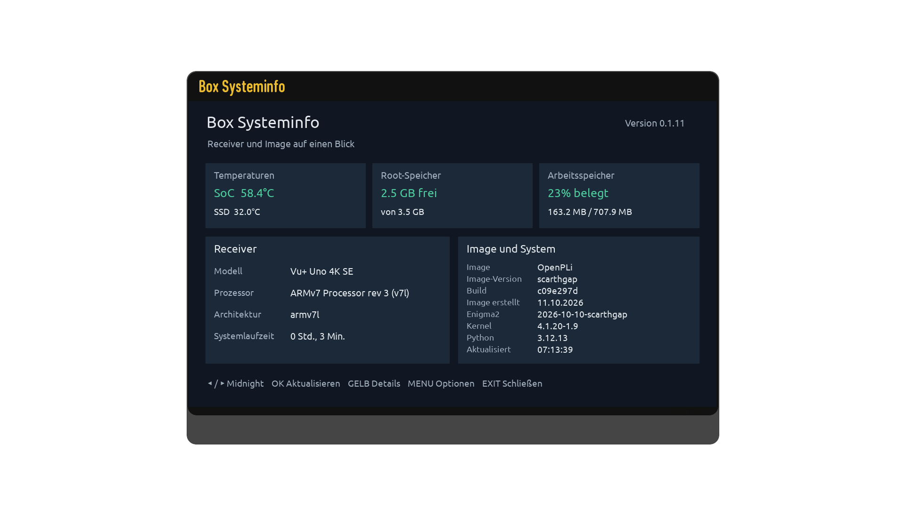</a> | **Recording storage** <a href="docs/screenshots/02-aufnahmespeicher.png">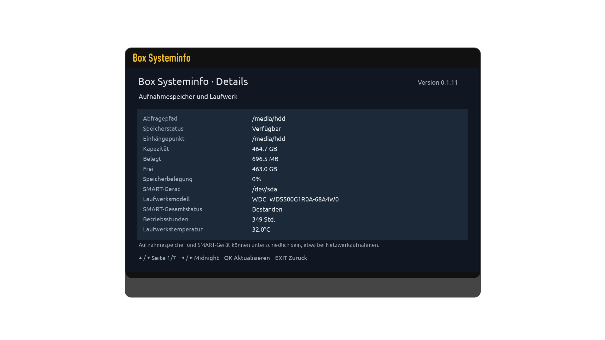</a> |
| **SSD health and errors** <a href="docs/screenshots/03-ssd-zustand.png">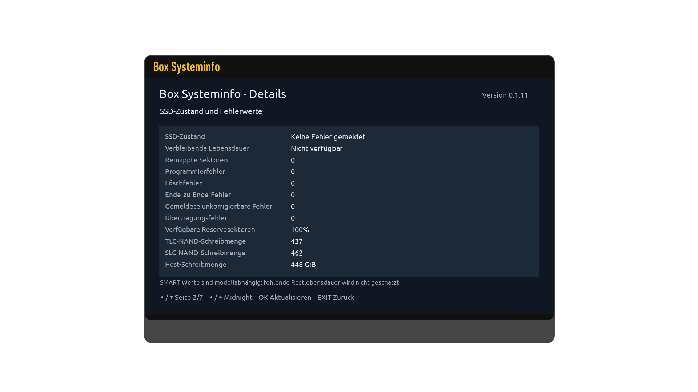</a> | **Processor** <a href="docs/screenshots/04-prozessor.png">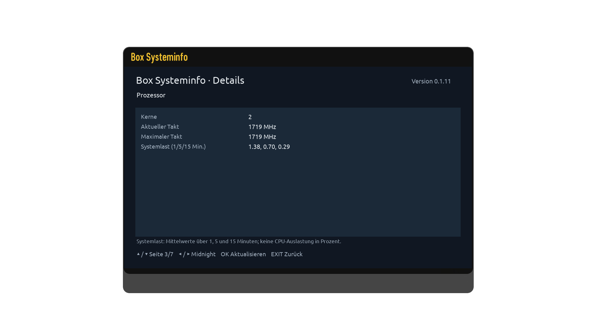</a> |
| **Memory and swap** <a href="docs/screenshots/05-arbeitsspeicher.png">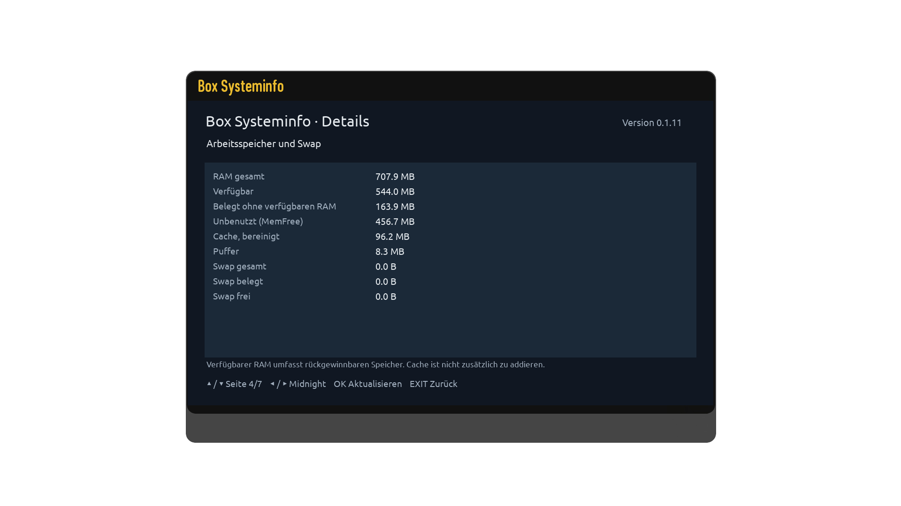</a> | **Network** <a href="docs/screenshots/06-netzwerk.png">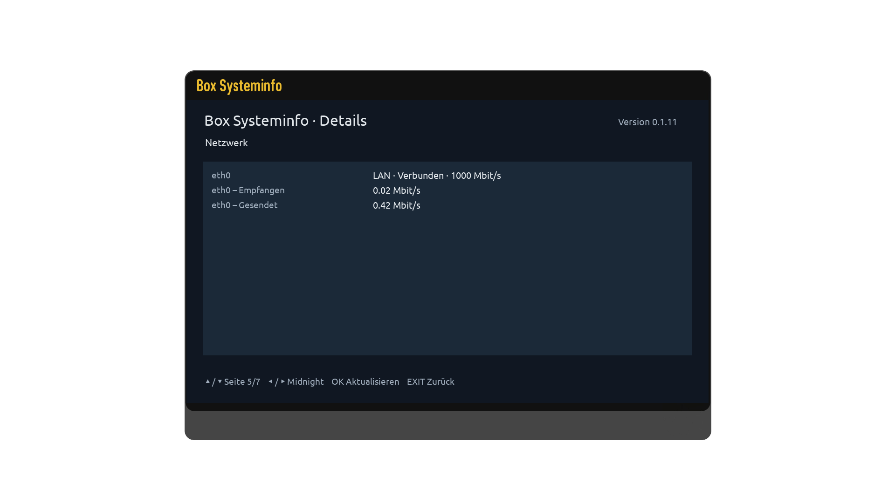</a> |
| **Tuners, page 1** <a href="docs/screenshots/07-tuner-1.png">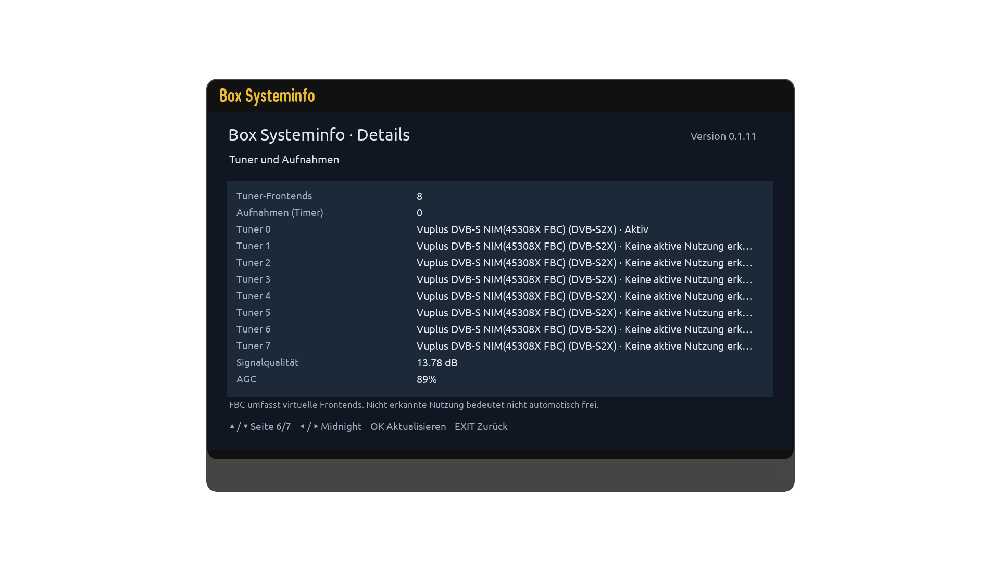</a> | **Tuners, page 2** <a href="docs/screenshots/08-tuner-2.png">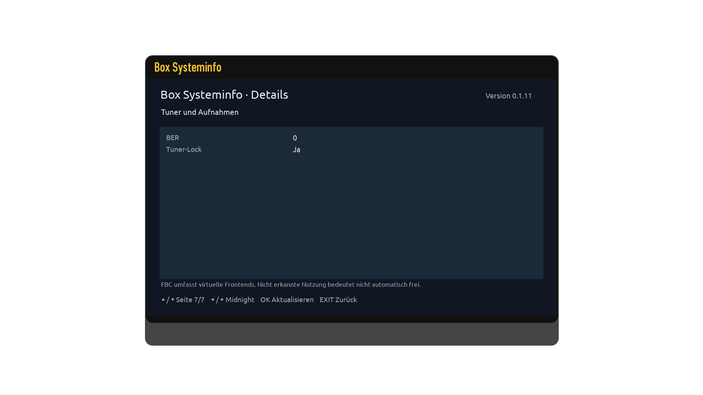</a> |
| **Options** <a href="docs/screenshots/09-optionen.png">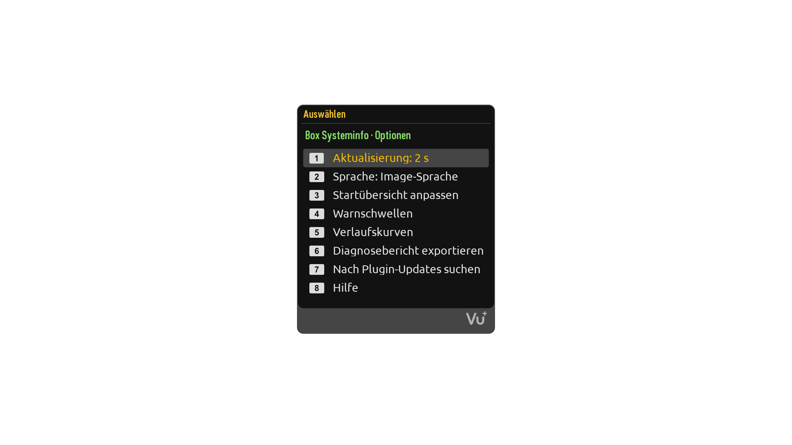</a> | **History charts** <a href="docs/screenshots/10-verlauf.png">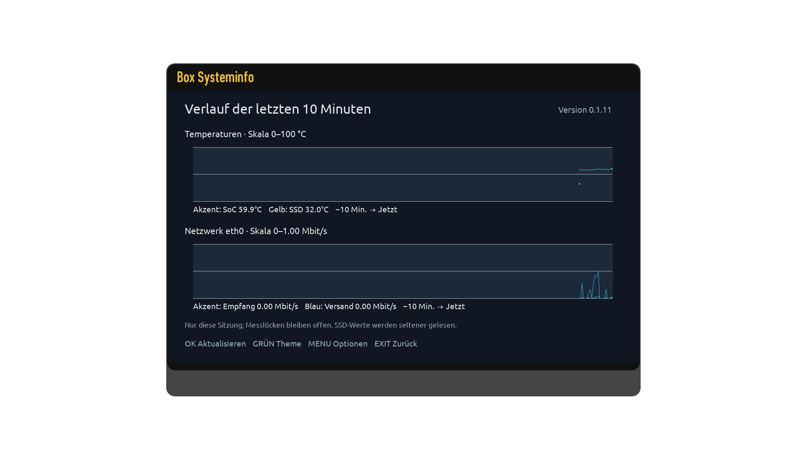</a> |
| **Overview card selection** <a href="docs/screenshots/11-kartenauswahl.png">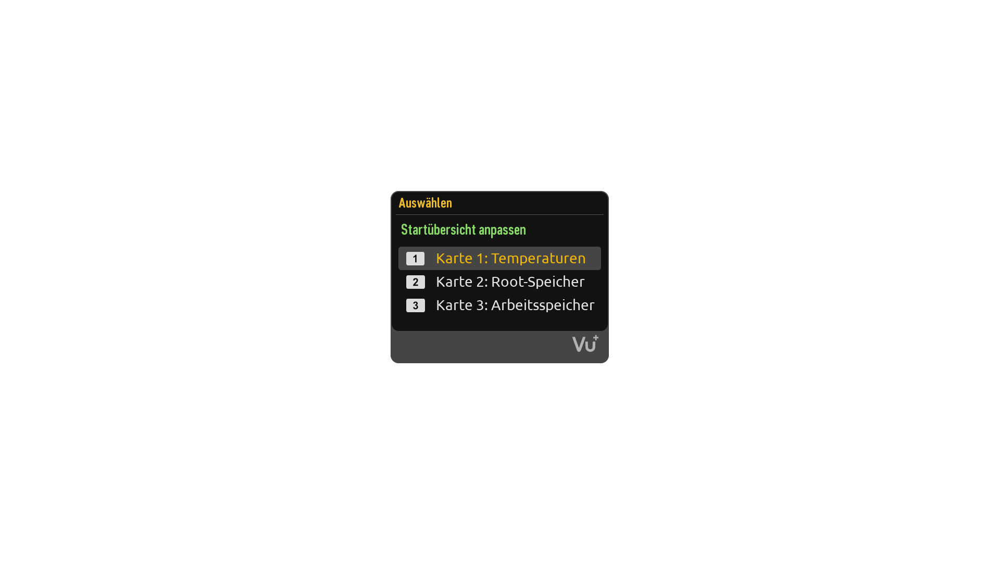</a> | **Warning thresholds** <a href="docs/screenshots/12-warnschwellen.png">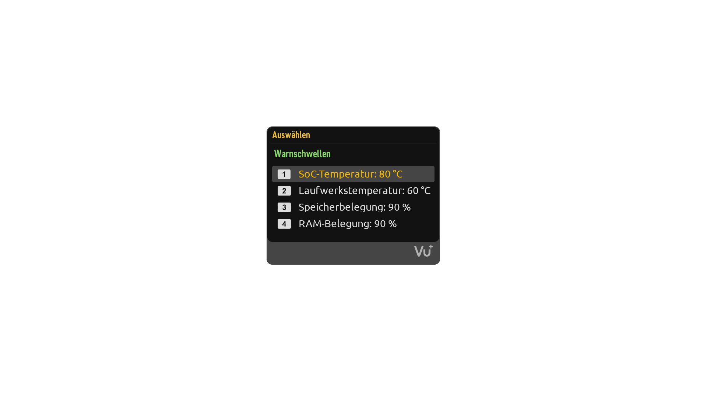</a> |
